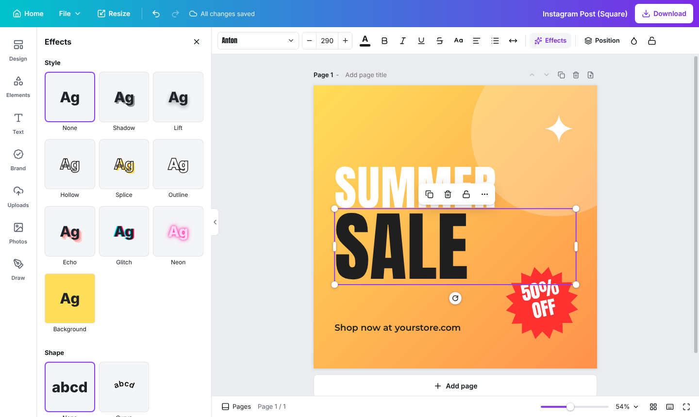
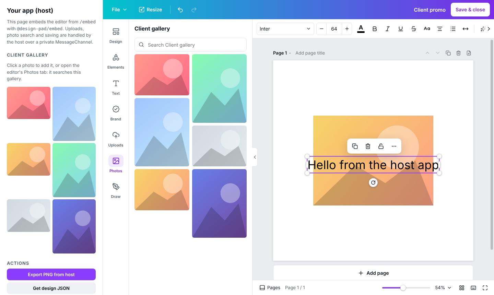

# Design Pad

A Canva-style design editor. It runs as a standalone web app, or inside another product as an SDK: a React component, a framework-free `mountDesignPad()` call, or a hosted editor in an iframe or a native mobile WebView.



## What it does

- **Content:** templates, lines and shapes, graphics, photo frames and grids, text styles and font pairings, uploads, photo search and freehand drawing.
- **Text:** 92 Google Fonts families, rich text edited in place, 9 text effects, curved text, lists, letter and line spacing.
- **Photos:** crop, flip, drop shadow, 14 adjustments and 18 filters. Filters run on WebGL, with a CPU fallback.
- **Layout:** multi-page designs, snapping guides, grouping, alignment, layers, resize to a new format, and keyboard shortcuts that follow Canva's.
- **Export:** PNG (optionally transparent), JPG, WebP, PDF (standard, or 300 DPI for print), a ZIP for multi-page images, and the editable design file (JSON).
- **Storage:** local first. The web app keeps designs, thumbnails and uploads in IndexedDB. Embedded, the editor asks the host to store files.

`docs/CANVA_STUDY.md` compares this feature by feature with Canva, including what is missing.

## Packages

| Package              | What it is                                                                                                 |
| -------------------- | ---------------------------------------------------------------------------------------------------------- |
| `@design-pad/core`   | Headless engine: document model, undo and redo, text layout, Canvas 2D renderer, image filters, exporters. |
| `@design-pad/editor` | The editor UI (React). Use it as a component, or mount it into any DOM node.                               |
| `@design-pad/embed`  | Host SDK for running the hosted editor in an iframe, plus the protocol used by native WebViews.            |
| `apps/web`           | The standalone app: home page, editor, the `/embed` route for hosts, and examples.                         |

## Run it

Needs Node 20 or newer and pnpm 10.

```bash
pnpm install
pnpm dev          # http://localhost:5173
```

Two example host pages ship with the dev server:
- http://localhost:5173/examples/embed-host.html drives the editor in an iframe through `@design-pad/embed`.
- http://localhost:5173/examples/mount.html mounts it without React, with and without Shadow DOM isolation.

| Command          | What it does                                                   |
| ---------------- | -------------------------------------------------------------- |
| `pnpm dev`       | Standalone app with hot reload                                 |
| `pnpm build`     | Builds the packages to `dist/` and the web app                 |
| `pnpm test`      | Unit tests (Vitest)                                            |
| `pnpm test:e2e`  | Playwright tests against a production build                    |
| `pnpm typecheck` | TypeScript across all packages, including the end-to-end tests |
| `pnpm lint`      | Biome lint and format check (`pnpm format` fixes what it can)  |

The web app reads two optional variables:

| Variable                     | Effect                                                                        |
| ---------------------------- | ----------------------------------------------------------------------------- |
| `VITE_UNSPLASH_ACCESS_KEY`   | Turns on Unsplash search in the Photos panel.                                 |
| `VITE_EMBED_ALLOWED_ORIGINS` | Comma-separated origins allowed to configure `/embed`. Empty allows any host. |

## Use it in your product

React:

```tsx
import type { DesignFile } from '@design-pad/core';
import { DesignPad } from '@design-pad/editor';
import '@design-pad/editor/styles.css';

const save = (file: DesignFile) =>
  fetch(`/api/designs/${file.id}`, { method: 'PUT', body: JSON.stringify(file) });

export function Editor({ design }: { design?: DesignFile }) {
  return (
    <DesignPad
      design={design}
      size={{ width: 1080, height: 1080 }}
      onChange={save} // debounced
      onSave={save} // Ctrl/Cmd+S
      style={{ height: '100vh' }}
    />
  );
}
```

Any other stack (Vue, Svelte, server-rendered pages):

```ts
import { mountDesignPad } from '@design-pad/editor';

const pad = mountDesignPad(document.getElementById('editor')!, {
  isolate: true, // Shadow DOM: your page's CSS cannot reach the editor
  size: { width: 1200, height: 628 },
  onChange: (file) => localStorage.setItem('draft', JSON.stringify(file)),
});
pad.editor.addElement({ type: 'text', spans: [{ text: 'Hello' }] });
```

From a different origin, or from a mobile app, run the hosted editor at `/embed`:

```ts
import { openDesignPad } from '@design-pad/embed';

const pad = await openDesignPad({
  container: document.getElementById('editor')!,
  editorUrl: 'https://design.example.com/embed',
  size: { width: 1080, height: 1350 },
  headerActions: [{ id: 'done', label: 'Done', variant: 'primary' }],
  onAction: (id, design) =>
    fetch(`/api/designs/${design.id}`, { method: 'PUT', body: JSON.stringify(design) }),
});
const { blob } = await pad.export({ format: 'png' });
```

`docs/EMBEDDING.md` covers all three, plus iOS (WKWebView), Android and Flutter hosts.



## Docs

- [Canva study and feature parity](docs/CANVA_STUDY.md)
- [Architecture](docs/ARCHITECTURE.md)
- [Embedding and SDK reference](docs/EMBEDDING.md)
- [Roadmap](docs/ROADMAP.md)

## Browser support

The automated tests run in Chromium. Safari and Firefox are supported targets but are not yet covered by the end-to-end suite. Image filters use WebGL and fall back to a CPU path when WebGL is unavailable.
