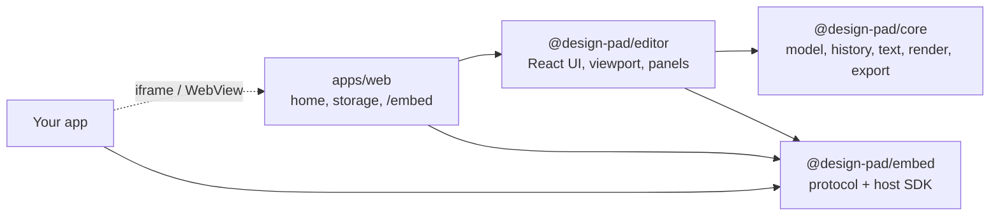
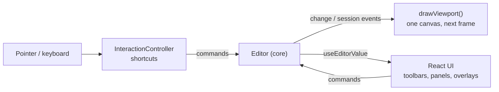
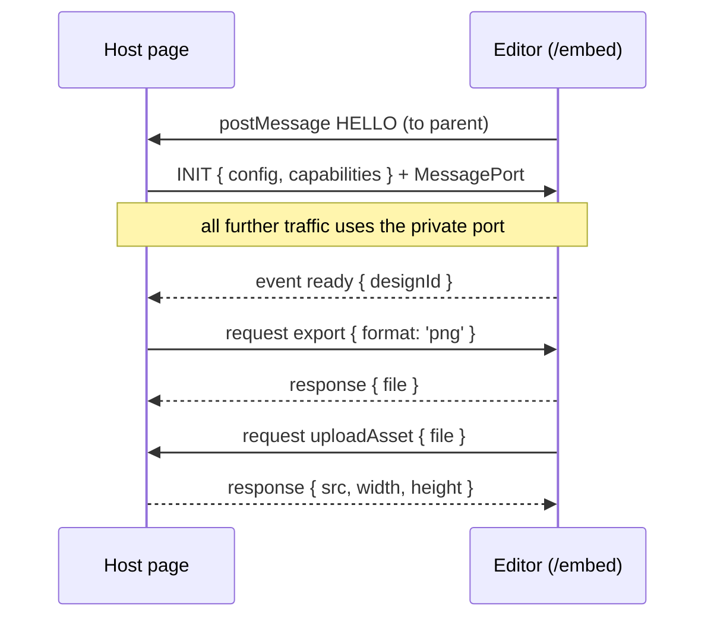

# Architecture

Design Pad has four parts. A headless engine owns the document. A React editor draws the engine's state and turns input into engine commands. A small protocol package lets other apps host the editor. The web app adds storage and routing.

`core` has no UI and no React. `embed` has no runtime dependency on the other packages, so a host page only downloads about 6 KB to drive the editor.

## Document model (`core/src/model`)

A design is a flat set of records, keyed by id:

| Record     | Holds                                                                                                                 |
| ---------- | --------------------------------------------------------------------------------------------------------------------- |
| `document` | Title, page size, unit (px, mm, cm, in) and DPI.                                                                      |
| `page`     | Title, background (solid, gradient or image) and an `index`.                                                          |
| `element`  | One of `text`, `shape`, `line`, `image`, `frame`, `grid`, `svg`, `path` or `group`, with a `parentId` and an `index`. |
| `asset`    | An image, SVG or font: a `src` plus intrinsic size and type.                                                          |

Two choices keep this ready for real-time collaboration:
- **Order is a fractional index** (`fractional-indexing`), not an array position. Moving an element rewrites one record, and two people inserting at the same spot do not conflict.
- **Nesting is a `parentId`**, not nested arrays. Every record can be synced and merged on its own.

Group children use coordinates relative to the group, so moving a group is a single write. A saved design (`DesignFile`) is the record list plus a `format` tag and a `schemaVersion`. `migrateDesignFile()` upgrades older files on load.

## Store, transactions and history (`core/src/store`)

All writes go through `Store.transact()`. A transaction collects one `RecordsDiff` (added, updated and removed records, each with its previous value). Listeners get one diff per outermost transaction, tagged with `ChangeMeta`:
- `source`: `user`, `history`, `remote` or `system`.
- `history`: `record` or `ignore`.

A `beforeChange` hook runs before each write. The engine uses it to keep derived data correct whatever wrote the record. For example, a text box's height is always re-measured from its content.

`History` builds undo steps from diffs:
- **Undo** applies the inverted diff and restores the selection from before the change. **Redo** re-applies the original and restores the selection from after it.
- **Interactions** (a drag, a resize, a slider scrub, a text-editing session) are wrapped in `startInteraction()` and `endInteraction()`. Every change in between is squashed into one step. `cancelInteraction()` (Escape mid-drag) rolls the changes back.
- Changes marked `history: 'ignore'` never become undo steps. Remote edits from a future sync layer would use this.

Session state (selection, the text being edited, crop mode, current page, focused group) lives in `Session`. It is not part of the document, so selecting things never creates undo steps.

## Text (`core/src/text`)

The layout engine reproduces how the browser lays out the editing overlay. The canvas render and the text you are typing into therefore line up to the pixel:
- Line breaking follows CSS `white-space: pre-wrap` with `overflow-wrap: break-word`. Words wrap at spaces. A word wider than the box breaks between graphemes.
- Line boxes use half-leading around a strut, as CSS does, so mixed font sizes on one line sit on a shared baseline.
- Alignment includes justify. Bullet and numbered lists indent the way the overlay's CSS does.
- Measurements come from the 2D context's `measureText` and are cached per font and string.

Curved text lays glyphs along a circular arc, with the radius taken from the curve amount. Text effects (shadow, outline, splice, echo, glitch, neon, background) are drawn on the canvas. Blurred shadows use the off-canvas shadow trick: draw the glyphs outside the visible area and offset the shadow back in, which renders a shadow without its source.

`FontManager` registers families from the catalog (92 Google Fonts) or from uploaded font assets. It loads each face on first use: Google Fonts through their CSS API, uploaded fonts as `FontFace` objects. It then waits on `document.fonts.load()` for the exact weight and style, and fires an event so text re-measures once a font arrives. The font picker previews each family with a `text=` subset request, which fetches only the letters of its name.

## Rendering (`core/src/render`)

`renderPage()` draws one page into any 2D context at any transform. The editor viewport, thumbnails and every exporter share it.
- `shapes.ts` defines each shape once, as a path written to a `PathSink`. The same definition draws on canvas and produces SVG path data for UI previews.
- `paint.ts` turns solid and gradient fills into canvas paints.
- `ResourceManager` caches decoded images and sanitised SVGs (scripts and event handlers removed). It also caches processed versions of photos for each set of adjustments and filter, at display size.
- `filters/` applies adjustments and filters. The WebGL path runs the colour adjustments in one fragment shader pass. Blur gets its own pass at reduced resolution, so large radii stay cheap. The CPU path is the fallback when WebGL is missing or fails, and it takes the same parameters.

## Export (`core/src/export`)

`exportDesign(editor, options)` renders pages to offscreen canvases, waiting for fonts and images first:
- **PNG, JPG and WebP:** one file per page; several pages are zipped with `fflate`.
- **PDF:** a small hand-written PDF 1.4 writer (`pdf.ts`). It embeds one JPEG or PNG image per page, sized in points from the design's DPI.
- **JSON:** the design file itself.

PDFs are raster today. Vector output and print marks are on the [roadmap](ROADMAP.md).

## The editor (`@design-pad/editor`)

**One canvas for all pages.** The viewport is a single `<canvas>` the size of the visible area, scaled by `devicePixelRatio`. A camera (scroll and zoom) decides which pages are visible. Pages are laid out in a vertical column, each with a header. Redraws are batched into the next animation frame. Only visible pages are drawn, so long documents cost little.

**DOM overlays on top of the canvas:**
- `SelectionOverlay` (SVG): handles, rotation, snap guides and the marquee.
- `PageChrome`: page titles, page actions and the "Add page" button.
- `FloatingToolbar`: the bar above the selection.
- `TextEditor`: a visible `contenteditable` placed exactly over the text being edited, with the canvas copy hidden. Its CSS mirrors the layout engine. Effects are approximated in CSS while you type.

**`InteractionController`** is a pointer state machine: select, marquee, move (with snapping and Alt to duplicate), resize, rotate, crop, draw, pan and pinch. Every gesture is one history interaction.

**State outside the document:**
- A small UI store holds panels, dialogs, guides and the drawing tool.
- A camera store holds scroll and zoom.

Components read engine state through `useEditorValue(selector)`, built on `useSyncExternalStore` with shallow equality. They re-render only when their slice changes.

**Robustness:**
- Panels, toolbars and the shell sit inside error boundaries. A broken panel shows "Try again" instead of unmounting the editor, which matters when you are a guest on someone else's page. Hosts receive the errors through `onError`.
- Keyboard handling uses `event.composedPath()`, so shortcuts and typing work inside a Shadow DOM mount.
- The stylesheet is scoped to `.dp-root`. The root resets the inherited text properties (case, spacing, weight, alignment). Form controls are reset through `:where()`, which beats host element selectors without outranking the editor's own rules. For complete isolation, mount with `isolate: true` (Shadow DOM).

## Embedding (`@design-pad/embed`)

`RpcPeer` is a symmetric request, response and event layer over any transport. Each side calls only the methods the other advertised. For example, the editor asks the host to store uploads only when the host provided `assets`.
- **iframes:** the transport is a transferred `MessagePort`. Blobs cross without copying, and other frames on the page cannot listen in. INIT is origin-checked against `VITE_EMBED_ALLOWED_ORIGINS`.
- **Native WebViews:** the same messages travel as JSON strings through `webkit.messageHandlers.designPad` (iOS), `DesignPadAndroid` (Android) or a `DesignPad` JavaScript channel (Flutter). Files become data URLs.

There is one handshake per page, so React StrictMode's double effects do not open two channels. If the editor page reloads, the host sees a new HELLO and replaces the channel.

## The web app (`apps/web`)

- **Local first:** designs, thumbnails and uploads are stored in IndexedDB. Uploads are referenced from designs as `idb://<id>` and resolved to object URLs through the editor's `assets.resolveUrl`. The design file stays small and portable.
- **Saving:** autosave is debounced on change. Going Home, or the page being hidden, saves immediately.
- **Routes:** `/` (home), `/design/:id` (editor) and `/embed` (editor for hosts). The editor routes are lazy-loaded, so the home page does not download the editor.

## Testing

- **Unit tests** (Vitest) cover the store, history, geometry, text layout, rendering helpers and the PDF writer.
- **End-to-end tests** (Playwright) run against a production build. Builds made with `VITE_E2E=true` expose the engine as `window.__designPad`, so tests assert on document state rather than pixels. The tests cover text editing and undo, multi-page drawing and downloads, uploads and filters, persistence, the iframe SDK and the Shadow DOM mount. Retries are off on purpose, so flaky tests get noticed.
